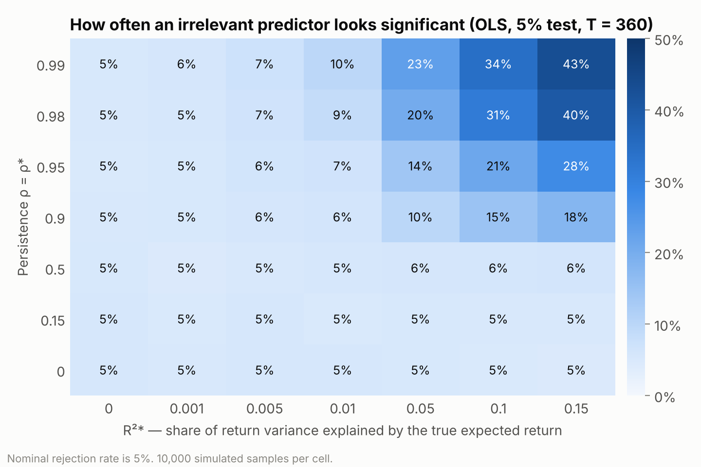
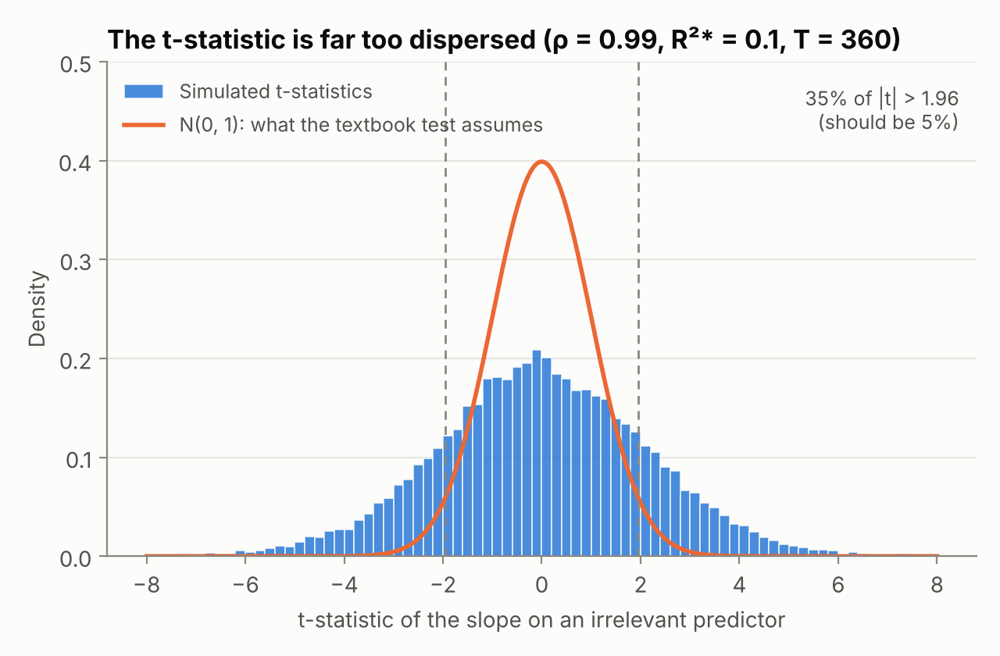
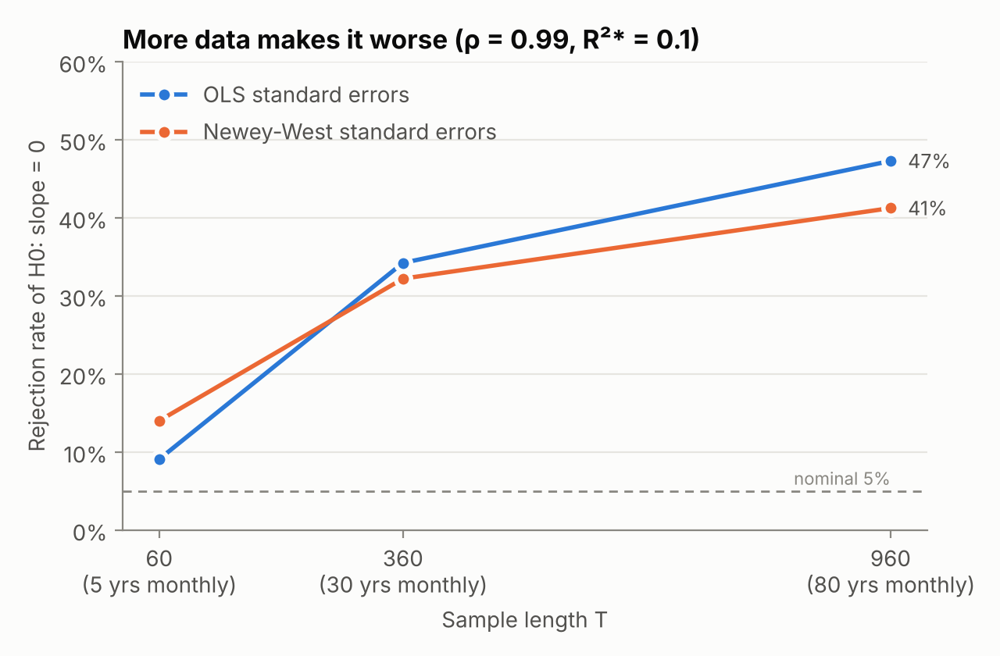
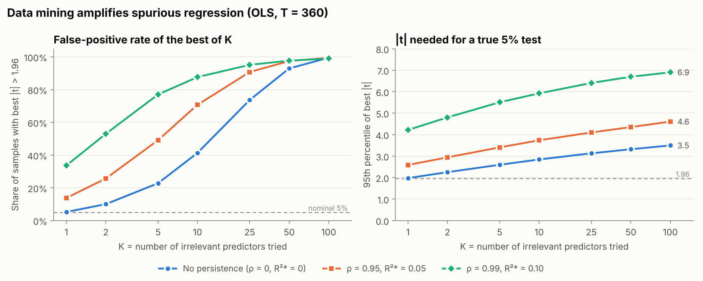

# Spurious Regressions in Return Predictability — a Monte Carlo study

Can a variable that has **nothing to do with stock returns** still look like a significant predictor?
This project reproduces, in simulation, the central mechanism of
Ferson, Sarkissian & Simin (2003), *"Spurious Regressions in Financial Economics?"*.



## Question

Predictive regressions of the form

```math
r_{t+1} = a + b\,Z_t + e_{t+1}
```

are everywhere in empirical finance (dividend yield, term spread, book-to-market …).
Most popular predictors are **highly persistent** (monthly autocorrelation above 0.9).
If expected returns are also persistent, how often does a *completely unrelated* but persistent
predictor produce |t| > 1.96?

## Design

| Component | Model |
|---|---|
| True expected return (unobserved) | $`Z^*_t = \rho^* Z^*_{t-1} + v_t`$ |
| Realised return | $`r_{t+1} = Z^*_t + u_{t+1}`$, with $`\mathrm{Var}(Z^*)/\mathrm{Var}(r) = R^{2*}`$ |
| Candidate predictor | $`Z_t = \rho Z_{t-1} + w_t`$, **independent** of $`Z^*`$ and $`u`$ |

- The true slope on $`Z_t`$ is exactly zero, so every rejection is a false positive.
- Grid: $`\rho = \rho^* \in \{0, 0.15, 0.5, 0.9, 0.95, 0.98, 0.99\}`$,
  $`R^{2*} \in \{0, 0.001, 0.005, 0.01, 0.05, 0.10, 0.15\}`$,
  $`T \in \{60, 360, 960\}`$ months.
- 10,000 simulated samples per cell; two-sided 5% t-test using
  (i) classical OLS standard errors and (ii) Newey-West HAC standard errors
  with the automatic lag rule $`\lfloor 4(T/100)^{2/9} \rfloor`$.
- All regressions are vectorised in NumPy (no loop over samples); the full grid runs in about a minute.

This is a study **in the spirit of** the paper, not an exact replication of its tables:
the grid, sample sizes and lag rule are my own choices.

## Results

Rejection rate of $`H_0: b = 0`$ with OLS standard errors, $`T = 360`$ (nominal size 5%):

| ρ = ρ* | R²* = 0 | R²* = 0.05 | R²* = 0.10 | R²* = 0.15 |
|---|---|---|---|---|
| 0.90 | 5.1% | 9.8% | 14.7% | 17.9% |
| 0.95 | 4.7% | 14.0% | 21.5% | 27.7% |
| 0.98 | 4.9% | 20.3% | 31.4% | 39.9% |
| 0.99 | 5.2% | 23.1% | 34.2% | 43.0% |

Full results for every cell and both standard errors: [`results/rejection_rates.csv`](results/rejection_rates.csv).

**1. Persistence alone is not enough — persistent expected returns are the trigger.**
When $`R^{2*} = 0`$ (returns are unpredictable noise), the test has the correct 5% size even with
$`\rho = 0.99`$. The problem appears only when the *returns themselves* contain a slow-moving
expected component. A persistent regressor then "picks up" that slow component by chance in a finite sample.

**2. The t-statistic is far too dispersed.** With $`\rho = 0.99`$, $`R^{2*} = 0.10`$, $`T = 360`$,
roughly a third of irrelevant predictors look significant.



**3. More data does not fix it — it gets worse.** Unlike most small-sample problems, the
false-positive rate *rises* with the sample length (OLS: 9% → 34% → 47%).



**4. Newey-West standard errors are not a cure.** They reduce the over-rejection only a little
in long samples (47% → 41% at $`T = 960`$), and in short samples they over-reject even when there
is no persistence at all (about 9% at $`T = 60`$), a known small-sample bias of HAC estimators.

## Extension: data mining on top of spurious regression

In practice a researcher rarely tests one predictor. Suppose they try **K independent candidate
predictors** on the same return series (none related to returns) and report only the one with the
largest |t|. This is what [`run_data_mining.py`](run_data_mining.py) simulates ($`T = 360`$, 10,000 samples).



False-positive rate of the best of K, with the |t| a "best of K" predictor would need to exceed for a
true 5% test in parentheses (OLS standard errors):

| K tried | No persistence (ρ = 0, R²* = 0) | ρ = 0.95, R²* = 0.05 | ρ = 0.99, R²* = 0.10 |
|---|---|---|---|
| 1 | 5.2% (1.98) | 13.8% (2.59) | 33.6% (4.22) |
| 5 | 22.8% (2.60) | 49.1% (3.41) | 77.0% (5.51) |
| 10 | 41.4% (2.84) | 70.8% (3.74) | 87.7% (5.92) |
| 25 | 73.7% (3.13) | 90.8% (4.10) | 95.2% (6.41) |
| 100 | 99.5% (3.50) | 99.5% (4.61) | 99.0% (6.90) |

**5. The two problems reinforce each other.** Mining alone follows the textbook formula
$`1 - 0.95^K`$ (the first column, a check on the code). With persistent predictors and persistent
expected returns, the curve shifts sharply up: trying just **5** candidates yields a "significant"
predictor in 77% of samples. Equivalently, the hurdle for genuine 5% significance rises from
1.96 to about **5.5** — a predictor with $`|t| = 3`$ would be entirely unremarkable.

## Why it matters

Many "significant" predictors in the return-predictability literature are persistent.
If the true expected return is also persistent, conventional t-statistics overstate significance,
and the problem compounds with **data mining** across many candidate predictors.
Practical implications: be sceptical of predictors with autocorrelation near one, judge them on
out-of-sample performance, and use simulation-based critical values rather than ±1.96.

## Reproduce

```bash
pip install -r requirements.txt
python tests/test_inference.py   # sanity checks (OLS vs lstsq, AR(1) moments, correct size when ρ = 0)
python run_simulation.py         # writes results/rejection_rates.csv  (~1 min)
python run_data_mining.py        # writes results/data_mining.csv    (~1 min)
python make_figures.py           # writes figures/*.png
```

## Project structure

```
├── src/
│   ├── dgp.py            # data-generating process (persistent expected return + independent predictor)
│   └── inference.py      # vectorised OLS and Newey-West t-statistics
├── tests/test_inference.py
├── run_simulation.py     # Monte Carlo grid → results/rejection_rates.csv
├── run_data_mining.py    # best-of-K extension → results/data_mining.csv
├── make_figures.py       # results → figures/
├── results/
└── figures/
```

## Possible extensions

- Correlated (rather than independent) candidate predictors, as real predictor sets usually are.
- Correlated innovations between returns and the predictor (Stambaugh, 1999, small-sample bias).
- Simulation-based or bootstrap critical values, and out-of-sample $`R^2`$ as an alternative yardstick.

## Reference

Ferson, W. E., Sarkissian, S., & Simin, T. T. (2003). Spurious regressions in financial economics?
*The Journal of Finance, 58*(4), 1393–1413.

Newey, W. K., & West, K. D. (1987). A simple, positive semi-definite, heteroskedasticity and
autocorrelation consistent covariance matrix. *Econometrica, 55*(3), 703–708.
